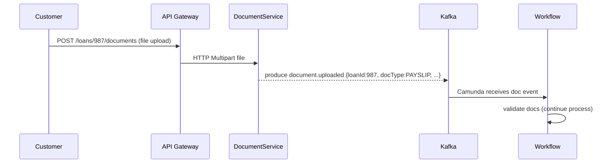

# Executive Summary  
We propose a **microservices-based Loan Origination & Credit Risk Assessment Platform** that modernises the loan process end-to-end. In scope are: customer-facing REST APIs for loan application, document upload, and status tracking; an **API Gateway**; **Keycloak/OIDC** for authentication and role-based access control; a **Camunda** workflow engine to orchestrate loan processing steps (validation, document verification, risk analysis, underwriting); **Kafka** for asynchronous domain events (loan submitted, docs uploaded, AI and credit results, approval/rejection); separate microservices for core functions (Loan Service, Document Service, Credit/Risk Service, AI Service, Audit Service, Notification Service); **Redis** for caching; and persistent storage in **PostgreSQL** with migration scripts via **Flyway**. We include an Outbox pattern to guarantee atomicity of DB writes and Kafka publishes, idempotency keys to avoid duplicate processing, and Kafka retry and Dead Letter Topics (DLT) for resilience. Security uses OAuth2/OIDC: Keycloak issues JWTs, Spring Security enforces **RBAC** based on roles in the token. All APIs are versioned and documented with Swagger/OpenAPI. Observability includes structured logging with correlation IDs (via Spring Cloud Sleuth), Spring Boot Actuator metrics exposed to Prometheus/Grafana, and centralized log tracing (e.g. ELK or Zipkin) to trace requests end-to-end. The platform will be containerised (Docker) and deployable to Kubernetes (with Helm charts) for portability and scalability. A staged implementation roadmap covers core functionality first (Loan Service + DB), then security, workflow, messaging, caching, AI, and finally auxiliary concerns (idempotency, locking, RAG). In what follows, we detail each component’s design, APIs, data model, and infrastructure, citing authoritative sources (Spring, Kafka, Camunda, Keycloak, etc.) as appropriate. Tables and Mermaid diagrams illustrate the architecture, flows, and contracts. 

## 1. Project Overview and Business Goals  
- **Objective:** Automate and streamline loan processing (origination to approval) with AI assistance, improving turnaround time and accuracy in a BFSI context.  
- **Business Goals:**  Reduce manual workload, enforce consistent credit rules, improve customer experience with a self-service portal, and ensure full auditability/compliance. All core tasks (validations, credit checks, underwriting) are governed by a configurable workflow (Camunda BPMN) so business analysts can adapt rules (e.g. new loan limits) without redeploying code.  
- **Key Requirements:** High availability and data consistency (no lost loan applications); strong security (BFSI compliance, role-based access, data encryption); full audit trail of actions; scalable architecture to handle many concurrent applications; recoverable event flows (Kafka DLQ); and integration of explainable AI insights without replacing human decision-making.  

## 2. Domain Model and ER Diagram  
We identify core entities (tables) roughly as follows:

| **Entity (Table)**          | **Key Fields (columns)**                                            | **Remarks**                                                                                     |
| --------------------------- | ------------------------------------------------------------------- | ---------------------------------------------------------------------------------------------- |
| *LoanApplication*           | id (PK), customer_id (FK), amount, term_months, interest_rate, status, application_date, created_by, updated_at, version (optimistic lock) | Core loan request; `status` tracks state (DRAFT, SUBMITTED, VERIFIED, ASSESSED, APPROVED, etc.).                                  |
| *Customer*                  | id (PK), name, date_of_birth, ssn, address, email, phone            | Borrower’s personal info.                                                                      |
| *LoanProduct*               | id (PK), name, max_amount, min_amount, interest_rate                | Catalog of loan types (home, auto, etc.), with limits/rules.                                    |
| *EmploymentInfo*            | id (PK), loan_id (FK), employer, monthly_income, years_employed      | Employment details linked to loan.                                                             |
| *FinancialInfo*             | id (PK), loan_id (FK), existing_emis (monthly), other_debts         | Borrower’s financial details (used for FOIR, etc.).                                           |
| *Document*                  | id (PK), loan_id (FK), type (payslip, ID, etc.), filename, uploaded_at, status | References to uploaded files; status (e.g. PENDING, VERIFIED, REJECTED). Files themselves may be stored on disk/S3; metadata here.|
| *AuditLog*                  | id (PK), entity_type, entity_id, action, timestamp, actor, details  | Audit trail (actions taken on loans, by whom).                                                 |
| *OutboxEvent*               | id (PK), aggregate (e.g. “LoanApplication”), aggregate_id, event_type, payload (JSON), created_at, published (flag) | For transactional outbox (events to publish to Kafka).                                         |
| *Notification*             | id (PK), loan_id (FK), type, status, sent_at, details               | (Optional) Logs notifications to send (email/SMS) about loan status changes. |

**Key fields**: Each table’s primary key (`id`). Foreign keys link `LoanApplication` to related info. `version` in LoanApplication for optimistic locking. Timestamps (created_at, updated_at) for auditing. Many-to-one (Loan->Customer, Loan->Product).

*Note*: We’ll use a tool like Flyway to create and migrate these tables (see next section). ER diagrams can be generated from these table definitions. 

## 3. Microservices Overview  

| **Service**           | **Responsibilities**                                                                                 | **Technology Stack**              |
| --------------------- | --------------------------------------------------------------------------------------------------- | --------------------------------- |
| **API Gateway**       | Route external requests to services, validate tokens (JWT), enforce CORS/rate limits. No business logic. Handles config (routing, TLS). | Spring Cloud Gateway             |
| **Auth/IAM (Keycloak)** | Identity provider; user login, token issuance, role management (not “built” by us, but we configure it).                                          | Keycloak (OAuth2/OIDC)            |
| **Loan Service**      | Manage loan applications: create, update, query. Expose REST APIs (/api/v1/loans). Persist to DB. Implements domain logic (e.g. loan eligibility DMN). Publishes events (loan.created, loan.submitted). | Spring Boot, Spring Data JPA (PostgreSQL) |
| **Document Service**  | Handle uploads/downloads of loan documents. Store files (local FS or S3). Extract text (Apache Tika). Validate docs (trigger workflow events). APIs under `/api/v1/loans/{loanId}/documents`.        | Spring Boot, REST, Tika, S3 SDK/LocalFS |
| **Workflow Service**  | Camunda BPM engine. Hosts/processes BPMN workflows for loan origination. Listens to start messages, timers, and manual tasks. | Camunda (embedded or standalone), Spring Boot |
| **Credit/Risk Service** | Compute credit metrics. Contains rules (FOIR, credit score eval). May call external credit bureaus (simulated). Applies DMN/Java rules to generate risk category. Emits events (risk.assessed).         | Spring Boot, possibly Drools (optional) |
| **AI Service**        | Perform AI analysis via LLM. Uses LangChain4j+Ollama to generate insights, summaries, missing docs. Listens on Kafka events, returns analysis. | Spring Boot, LangChain4j, Ollama LLM |
| **Audit Service**     | Central audit logging. Consumes events (Kafka) or HTTP calls to record actions in `AuditLog`. Provides API `/api/v1/audit` for admins to query logs. | Spring Boot, JPA |
| **Notification Service** | Send out notifications (email/SMS) when loans transition states. E.g. on approval/rejection, send email. Consumes events. May call external SMTP/SMS. | Spring Boot, Kafka consumer (send emails) |

Each microservice has its own DB or storage (Kafka is shared). They expose only their specific APIs (e.g. only Loan Service exposes `/loans` endpoints). Services communicate mostly via asynchronous Kafka events, except API Gateway calls (HTTP) and Camunda (usually sync via REST tasks). 

## 4. API Design  

All service APIs are versioned (e.g. `/api/v1/...`) and use JSON. Below are representative endpoints and DTOs (request/response). *Authorization*: Clients call via the API Gateway with a Bearer JWT (Keycloak-issued).

- **Loan Service (loans)**  
  - `POST /api/v1/loans` – Create a new loan application (draft). **Request**: JSON with customerId, productId, amount, term, income, etc. **Response**: LoanApplicationDTO with `id`, initial status `DRAFT`.  
    ```json
    { "customerId": 123, "productId": 5, "amount": 250000, "termMonths": 240 }
    ```  
    **Reply (200/201)**:  
    ```json
    { "loanId": 987, "status": "DRAFT", "applicationDate": "2026-09-19" }
    ```
  - `PUT /api/v1/loans/{id}` – Update fields of a draft loan. **Req**: fields to update.  
  - `POST /api/v1/loans/{id}/submit` – Submit application for processing. No body. **Effects**: triggers workflow, emits `LoanApplicationSubmitted` event. **Response**: updated LoanApplicationDTO (status=PENDING).  
  - `GET /api/v1/loans/{id}` – Get loan details (including status, assigned tasks).  
  - `GET /api/v1/loans?page=..&size=..&status=..` – List loans with pagination/filter.  
  - (Optional) `PATCH /api/v1/loans/{id}/status` – (Internal) update status.  

- **Document Service**  
  - `POST /api/v1/loans/{loanId}/documents` – Upload a document (multipart/form-data). Parameters: `type` (e.g. “PAYSLIP”). **Response**: Document metadata (id, status=PENDING).  
  - `GET /api/v1/loans/{loanId}/documents` – List uploaded docs for a loan.  
  - `GET /api/v1/documents/{docId}` – Download a document file.  

- **Credit/Risk Service** (internal)  
  - `POST /api/v1/assess` – (Or Kafka-triggered) Return risk category. **Req**: creditScore, FOIR, etc. **Res**: riskCategory (e.g. “LOW”, “HIGH”), recommended decision.  

- **AI Service** (internal)  
  - `POST /api/v1/analyze` – (Or Kafka) Provide LLM insights. **Req**: loan data + docs text. **Res**: AIAnalysisDTO (summary, missingDocs, explanations).  

- **Audit Service**  
  - `GET /api/v1/audit?entity=LoanApplication&entityId=987` – Retrieve audit events for the loan.  

- **Notification Service** (internal)  
  - (Consumed events only; no external API).  

**Sample Event (Kafka)**: Each microservice publishes domain events in JSON. For example, on submission:  
```json
{
  "loanId": 987,
  "customerId": 123,
  "eventType": "LoanApplicationSubmitted",
  "timestamp": "2026-09-19T10:15:00Z",
  "data": { "amount": 250000, "termMonths": 240 }
}
```  
(Exact fields depend on the event.) Topics are named like `loan.application`, `loan.submission`, `document.upload`, `ai.analysis`, `credit.assessment`, `loan.approval`, `loan.rejection`. See Section 5 for all topics and schemas.

## 5. Kafka Topics, Schemas and Sample Payloads  

We use Apache Kafka for event-driven communication. Key topics (with JSON schemas and example payloads):  

| **Topic**                          | **Schema/Key Fields**                             | **Example Payload**                        |
| ---------------------------------- | ------------------------------------------------- | ------------------------------------------ |
| `loan.application`                 | `{ loanId, customerId, productId, amount, termMonths, status, createdAt }` | `{ "loanId":987, "customerId":123, "productId":5, "amount":250000, "termMonths":240, "status":"DRAFT", "createdAt":"2026-09-19T10:00Z" }` |  
| `loan.submitted`                   | `{ loanId, submittedBy, timestamp }`              | `{ "loanId":987, "submittedBy":"user1", "timestamp":"2026-09-19T10:15Z" }`  |  
| `document.uploaded`                | `{ loanId, docId, docType, filename, uploadedBy, timestamp }` | `{ "loanId":987, "docId": 555, "docType":"PAYSLIP", "filename":"payslip.pdf", "uploadedBy":"user1", "timestamp":"2026-09-19T10:17Z" }`  |  
| `document.verified`                | `{ loanId, docId, verifiedBy, outcome, timestamp }` | `{ "loanId":987, "docId":555, "verifiedBy":"system", "outcome":"OK", "timestamp":"2026-09-19T10:20Z" }` |  
| `ai.analysis`                      | `{ loanId, summary, missingDocs[], riskFactors[], confidence }` | `{ "loanId":987, "summary":"Applicant income is stable...", "missingDocs":[],"riskFactors":["High EMI burden"],"confidence":0.82 }` |  
| `credit.assessment`                | `{ loanId, creditScore, foir, riskCategory, recommendation }` | `{ "loanId":987, "creditScore":720, "foir":0.38, "riskCategory":"MEDIUM", "recommendation":"PROCEED" }` |  
| `loan.approval`                    | `{ loanId, approvedBy, amountApproved, timestamp }` | `{ "loanId":987, "approvedBy":"manager1", "amountApproved":250000, "timestamp":"2026-09-19T11:00Z" }` |  
| `loan.rejection`                   | `{ loanId, rejectedBy, reason, timestamp }`      | `{ "loanId":987, "rejectedBy":"manager1", "reason":"Low credit score", "timestamp":"2026-09-19T11:00Z" }` |  

*(Additional topics: e.g. `loan.disbursed` when funds sent; `audit.events` consumed by Audit Service, etc.)*  

Each topic typically uses the loanId (or docId) as the message key for ordering by aggregate. We may use JSON Schema or Avro for schemas; at minimum document these structures in API docs. 

## 6. Process Flow Diagrams  

We illustrate main flows with Mermaid diagrams:

```mermaid
flowchart LR
  %% Loan submission and processing
  user(User) -->|1. POST /loans| API_Gateway(API GW)
  API_Gateway -->|2. →Loan Service| LoanService
  LoanService -->|3. creates Loan, emits Event| Kafka("Kafka Loan Topic")
  Kafka --> Workflow["Camunda Workflow Engine"]
  Workflow --> DocumentSvc["Document Service"]
  Workflow --> AISvc["AI Service"]
  Workflow --> CreditSvc["Credit/Risk Service"]
  Workflow --> Manager["Manager (User Task)"]
  Manager -->|Approve/Reject| Workflow
  Workflow --> LoanService
  LoanService -->|4. Update status| Kafka
  NotificationSvc["Notification Service"] <--|subscribes| Kafka
  AuditSvc["Audit Service"] <--|subscribes| Kafka
```

This flowchart (above) shows: the user creates/submits a loan via the API Gateway, Loan Service persists it and publishes a Kafka event. Camunda picks up the workflow (steps 4–8 below), invoking Document, AI, and Credit services. The process includes a manager user-task. Final approval or rejection triggers LoanService to mark application approved or rejected and publish events. The Notification and Audit services consume Kafka events to send alerts and record an audit trail.

### Main Business Flows  
1. **Create & Submit Loan:** Customer fills application → `POST /loans` → Loan Service saves and returns ID. Then `POST /loans/{id}/submit` is called, which starts the Camunda process (workflow) and publishes `LoanApplicationSubmitted`.  
2. **Document Verification:** As part of the workflow, Camunda invokes a service task to verify required documents. When the user uploads docs (`POST /loans/{id}/documents`), Document Service saves the file and emits `document.uploaded`. Camunda’s process waits for all doc events, then marks documents verified (or raises errors).  
3. **AI Analysis:** Camunda calls the AI Service (via HTTP or an async event). The AI Service queries loan data (and/or embedded DB docs), calls the LLM via LangChain4j+Ollama, and returns an analysis JSON. Camunda stores this in process variables.  
4. **Credit Assessment:** Camunda then invokes the Credit/Risk Service (either via REST or event). That service fetches credit history (simulated) and existing liabilities, computes FOIR (e.g. monthly EMIs ÷ income) and risk score. Simple decision rules/DMN determine if credit is acceptable (e.g. FOIR <0.5). The result is given back to Camunda, which sets a variable like `riskCategory`.  
5. **Manager Approval:** If not auto-approved/rejected by rules (e.g. extremely high/low scores), Camunda assigns a user task to an underwriter (“Manager”). The Manager reviews the application (with all data and AI summary) via a UI. They click Approve/Reject, which completes the task in Camunda, setting the loan status.  
6. **Finalization:** On approval, Camunda notifies Loan Service (via REST or event) to mark the loan “APPROVED” and trigger fund disbursement (outside scope). On rejection, similarly mark `REJECTED`. Both cases emit Kafka events (`loan.approval` or `loan.rejection`) that downstream services consume (Audit, Notification, UI updates).

For example, **Document Upload Flow**: 



*(The diagrams are illustrative; Camunda’s internal BPMN model (below) drives these interactions.)*

## 7. Camunda BPMN Workflow  

The loan origination process is modelled in Camunda with BPMN (Business Process Model and Notation). Key steps and variables:  

- **Start Event**: Triggered by `submitLoan` message or HTTP call.  
- **Validation Task**: A service task runs basic validation (check all required fields, limits by loan type). If invalid, route to a “Reject Application” end event.  
- **Parallel Tasks**: In parallel or sequence, Camunda calls: 
  - Document Verification (receives `document.uploaded` events, via an External Task or Message Catch).
  - Credit Check (calls Credit Service).
  - AI Analysis (calls AI Service).
- **Decision (DMN/Gateway)**: After receiving results, a decision (could be a DMN table) checks credit rules. For example: “if credit score >800 then auto-approve; if <500 auto-reject; else continue”.  
- **User Task (Underwriter Review)**: If still pending, a manager/underwriter reviews. This is a human task with Camunda form/assignee.  
- **End Events**: Approved or Rejected. Each path updates the loan status accordingly.  

Camunda Variables include: `loanId`, `validationResult`, `creditScore`, `foir`, `riskCategory`, `aiSummary`, `approvedBy`, etc. These drive the gateways. (For example, a boolean `autoApproved` could come from a DMN table.)  

*Example BPMN snippet (textual)*: 
```
StartEvent -> ServiceTask(ValidateApplication) -> Gateway(Valid? Yes->next, No->EndReject)
-> ParallelGateway -> [ServiceTask: VerifyDocuments] 
                  -> [ServiceTask: CallCreditService] 
                  -> [ServiceTask: CallAIService]
-> ParallelGateway (joined)
-> ServiceTask (EvaluateRules via DMN)
-> ExclusiveGateway (branch: auto-approve / auto-reject / managerReview)
-> UserTask (ManagerReview) -> Gateway -> (Approved or Rejected)
-> EndEvent
```
This ensures the process is transparent and modifiable via Camunda’s Modeler. Simple rules (loan limits, credit score thresholds) are moved into DMN tables in the model. 

## 8. Database Schema & Migration  
We use PostgreSQL for persistence. Each service has its own schema (or dedicated tables). For example, the Loan Service DB includes `loan_applications`, `employment_info`, `financial_info`, etc. Migrations are managed by **Flyway** (recommended over `ddl-auto=update` for production). For instance, versioned SQL scripts named `V1__Init_Loan_Schema.sql`, `V2__Add_version_column.sql`, etc. Flyway tracks applied scripts in `flyway_schema_history`. 

*Sample table (Flyway script)*:
```sql
CREATE TABLE loan_application (
  id SERIAL PRIMARY KEY,
  customer_id INT NOT NULL,
  product_id INT NOT NULL,
  amount NUMERIC(12,2) NOT NULL,
  term_months INT NOT NULL,
  status VARCHAR(20) NOT NULL,
  application_date TIMESTAMP NOT NULL DEFAULT NOW(),
  version BIGINT NOT NULL DEFAULT 0,
  created_by VARCHAR(50), updated_at TIMESTAMP,
  UNIQUE (id)
);
-- add foreign key, indexes, etc.
```
A **migration strategy** is: (a) Write SQL scripts under `src/main/resources/db/migration`. (b) On application start, Flyway auto-applies any pending scripts (if `spring.flyway.enabled=true`). (c) Never edit an applied script; always create a new version script for changes. This ensures repeatable builds and easy rollback if needed. 

Use **transactional DDL** carefully: ideally Flyway runs at startup (before app queries tables). 

## 9. Outbox Pattern  
To ensure atomicity between DB writes and Kafka events, we adopt the *Transactional Outbox* pattern. Instead of writing and publishing in separate transactions (which can lose data on failure), we do this:  

1. In the same DB transaction where we modify a business entity (e.g. saving a Loan), we also insert a row in an `outbox_event` table (with columns like `id`, `aggregate_type`, `aggregate_id`, `event_type`, `payload`, `created_at`).  
2. Commit the DB transaction. Now the event is durably recorded.  
3. A separate background process or scheduler polls the `outbox_event` table (or listens via Debezium) to publish these events to Kafka, then marks them as published or deletes them.

*Example outbox table SQL*:  
```sql
CREATE TABLE outbox_event (
  id BIGSERIAL PRIMARY KEY,
  aggregate_type VARCHAR(50) NOT NULL,
  aggregate_id VARCHAR(50) NOT NULL,
  event_type VARCHAR(100) NOT NULL,
  payload JSONB NOT NULL,
  created_at TIMESTAMP NOT NULL DEFAULT NOW(),
  published BOOLEAN NOT NULL DEFAULT FALSE
);
```
In code, when saving a loan, we also do `INSERT INTO outbox_event(...)` within the same transaction. This guarantees **exactly-once delivery** of events even if the app crashes between the DB commit and Kafka send. (We can cite the general principle: the outbox ensures *data consistency across service and message bus*.) 

## 10. Kafka Consumer/Producer Patterns  
- **Producers**: Should set `enable.idempotence=true` (default in recent Kafka) to avoid duplicates. Use `acks=all`. To implement *exactly-once semantics* across multiple partitions, Kafka transactions could be used, but here the outbox pattern obviates cross-topic transactions.  
- **Consumers**: We use manual offset commits after processing a message. If a consumer fails, it should not auto-commit before handling; instead, acknowledge (commit) only on success (at-least-once processing).  
- **Retry & DLT**: For recoverable errors in consumers (e.g. temporary DB failure), use a retry topic. For example, if NotificationService fails to send an email, it can republish the message to `loan.notification.retry`. After N retries, failed messages go to `loan.notification.dlq` (dead-letter queue). This aligns with best practices in Kafka: “DLQs aren’t optional infrastructure; they’re your early warning system”. Monitor DLQ topics and alert on surges.  
- **Idempotency Keys**: For APIs that might be called twice (e.g. the user clicks Submit twice), include an `Idempotency-Key` header or use unique message keys. Services should check for duplicate event processing (e.g. maintain a dedup table or use Kafka’s log compaction).  
- **Offset Management**: Use consumer groups (one group per logical subscriber). With manual commit, call `consumer.commitSync()` only after processing. For stateful consumers, consider storing the last processed ID in a DB to resume. (Spring Kafka lets you configure acknowledgement modes; see [11] for examples.)

*Monitoring*: Use Kafka’s JMX metrics or Confluent Control Center. Ensure retention on topics is long enough to allow replay (e.g. 7 days). On outages, you can `kafka-consumer-groups` to reset offsets and replay.  

## 11. Security Design (Keycloak/OIDC, JWT, RBAC)  

We use **Keycloak (OpenID Connect)** as our Identity Provider (IdP). All APIs validate JWTs issued by Keycloak. Keycloak hosts realms, clients, and roles. Example setup: one realm “LoanRealm”, with clients “loan-frontend” (public) and “loan-backend” (confidential).  

- **Login Flow (Auth Code)**: The frontend (React web) performs OAuth2 Authorization Code flow via Keycloak. The user logs in on Keycloak; a code is exchanged for an Access Token and Refresh Token. This access token (JWT) is sent by the client in `Authorization: Bearer <token>` on API calls.  
- **Token Validation**: In Spring Boot services, use `spring-boot-starter-oauth2-resource-server`. Configure `spring.security.oauth2.resourceserver.jwt.issuer-uri` to Keycloak’s realm URL (e.g. `http://keycloak:8080/realms/LoanRealm`). Spring auto-fetches JWKS and verifies signatures. We can also configure `jwk-set-uri` explicitly if needed.  

- **Roles & Authorities**: Keycloak realm roles (e.g. “loan_officer”, “manager”, “admin”) appear in the token under `realm_access.roles`. Client roles (per-app roles) appear under `resource_access.{client}.roles`. We map these to Spring `GrantedAuthority` (usually prefixing with `ROLE_`). For example, if a token has `"realm_access":{"roles":["loan_officer"]}`, then Spring sees authority `ROLE_LOAN_OFFICER`. We can also use Spring Security’s `@PreAuthorize("hasRole('loan_officer')")` on endpoints.  

- **RBAC Mapping**: Define which endpoints require which roles. For instance:  
  - Endpoints `/api/v1/loans/**` (create/submit) require role `USER` or `LOAN_OFFICER`.  
  - Underwriter actions (`/api/v1/loans/{id}/manager-approve`) require `LOAN_OFFICER` or `MANAGER`.  
  - Admin endpoints (`/api/v1/admin/**`) require `ADMIN`.  

- **API Gateway**: We configure Spring Cloud Gateway with `OAuth2ResourceServer` support, so it can also validate tokens on incoming requests, or it can simply route to services which re-validate. The Gateway can check token validity (and even cache valid tokens) to block unauthorized calls early. Do **not** put business-logic checks in the gateway; it only checks scope/expiration. Actual access control is in each service (via Spring Security).  

- **JWT Claims**: We include standard claims (`sub`, `iat`, `exp`) and realm roles. We may add custom claims (e.g. `departments`, `region`) if needed. All microservices should only trust claims signed by Keycloak (verify issuer).  
- **Client-to-Service Auth**: For service-to-service calls (Camunda tasks or Kafka triggers), we can use a client credentials flow: each service has its own clientId/secret in Keycloak. The service obtains a token (or we configure Spring to use OIDC for internal REST templates).  

- **Secure Communications**: All HTTP (Gateway ↔ clients, Gateway ↔ services, service-to-service) use HTTPS/TLS in production. Kafka too should use SSL for client-broker. We terminate TLS at the ingress or use mutual TLS as needed.

*Example config snippet (application.yml)*:  
```yaml
spring:
  security:
    oauth2:
      resourceserver:
        jwt:
          issuer-uri: http://localhost:8080/realms/LoanRealm
```
This tells Spring to fetch Keycloak’s JWKS keys from `/.well-known/openid-configuration`.  

## 12. Caching Strategy (Redis)  

We use Redis as a cache to improve read performance and reduce DB load. Possible uses: caching loan status lookups, caching frequently accessed reference data (loan products, rate tables), or caching completed credit reports for reuse.  

- **What to Cache**: Non-sensitive, relatively static data. E.g. `LoanProduct` info, or loan summaries on a dashboard (with short TTL). We *could* cache loan application details (`GET /loans/{id}`) to avoid DB hits if many similar reads. **However**: any update (e.g. status change) should evict or update the cache. Use `@Cacheable` on read methods and `@CacheEvict` on write methods in services.  
- **TTL & Eviction**: Set a modest TTL (e.g. 5–15 minutes) on caches like loan lookups to handle stale data gracefully. Configure Redis `maxmemory-policy=volatile-lru` or similar. On events like loan approval, explicitly evict the relevant cache key so that stale data isn’t served. For session data (if any), use short TTLs (e.g. 30 min).  
- **Consistency**: Because we have critical status changes, we must invalidate caches on change. Spring provides `cacheManager.getCache("loans").evict(loanId)` calls in the Loan Service.  
- **Example**:  
  ```java
  @Cacheable(value="loanApps", key="#loanId")
  public LoanApplicationDTO getLoanById(long loanId) { ... }
  
  @CacheEvict(value="loanApps", key="#loan.id")
  public LoanApplicationDTO saveLoan(LoanApplicationDTO loan) { ... }
  ```

In summary, Redis caching (Spring Cache) should be used judiciously for read-heavy data, with clear invalidation logic on updates. This adds scalability (serving from Redis vs always DB) at the cost of cache management.  

## 13. Document Storage & Text Extraction  

Documents (payslips, IDs, etc.) require secure storage and processing. Options:  

- **Storage**: For dev, a local filesystem folder or Docker volume is simplest. For production, use cloud/object storage (e.g. AWS S3, Azure Blob, MinIO) with server-side encryption (SSE). The Document Service stores the **metadata** (filename, loanId, status) in DB, and the actual binary file in storage.  
- **Security**: Encrypt documents at rest. Enforce access control (only loan-related services/users can fetch files). We must consider PCI/DSS or GDPR if storing sensitive info (encrypt, audit access, allow deletion).  
- **Text Extraction Pipeline**: We integrate an open-source extraction library (Apache Tika) to parse common document types (PDF, DOCX, images with OCR). Upon upload, the Document Service streams the file to Tika to extract text; the text can be passed to the AI Service (e.g. to verify stated income or detect missing info).  

  Example (Java pseudocode):  
  ```java
  try (InputStream in = file.getInputStream()) {
      String text = new AutoDetectParser().parseToString(in, new BodyContentHandler());
      aiService.submitDocumentText(loanId, docId, text);
  }
  ```
  This extracted text then becomes part of the AI prompt (or stored as a Camunda variable).  

- **Workflow Integration**: If any document is missing or fails verification (e.g. Tika cannot parse or an ID is blurry), the Document Service or Camunda could flag an issue. The AI Service could also list missing docs.  

We cite no specific source here; this is standard practise (Tika is industry-recognized for extraction). 

## 14. AI Integration (LangChain4j + Ollama, RAG)  

Our AI Service uses **LangChain4j** to interact with an LLM running on **Ollama** (a local model server). LangChain4j provides a Java API for LLMs. We configure it to use Ollama’s endpoint (e.g. a local Llama-3-13b model).  

- **Prompt Templates**: Build prompts/templates for our use-cases. For example, to generate a loan summary:
  ```
  Prompt: "Loan Application Summary:\n- Amount: ${amount}\n- Income: ${income}\n- Credit Score: ${score}\nGenerate an applicant summary and highlight any risk factors. Provide confidence level between 0 and 1."
  ```
  LangChain4j’s *PromptTemplate* feature formats this with the loan’s data.  
- **AI Output**: The AI Service calls LangChain4j’s chat API. The response is parsed into a structured result: a summary string, array of risk factors (strings), maybe missing documents list, and the model’s self-reported `confidence`.  

- **Integration Flow**: Camunda sends a message/event `loan.analysis.request`. The AI Service consumes it, collects all relevant data (loan details, docs text), constructs the prompt, and awaits the LLM’s answer. It then produces `loan.analysis.completed` event (as in Section 5).

- **Retrieval-Augmented Generation (RAG)** – *Phase 2 (optional extension)*: We plan ahead to support RAG. Later, we can ingest policy manuals or loan guidelines into a vector DB (e.g. Pinecone or a local Milvus instance) for on-the-fly Q&A. LangChain4j supports RAG pipelines. For now, it’s out of scope, but our AI design allows plugging in such capabilities (e.g. answering “what docs are needed for a salaried home loan?” by searching embedded policy documents).  

- **LLM Choices**: Ollama can serve Llama models (which are open-source). We avoid ChatGPT due to cost and privacy. By running our own model (e.g. Llama 3, Mistral, etc.), we have full control and offline capability. LangChain4j makes it easy to switch providers later (it also supports OpenAI, etc. if needed).

*No citation needed beyond LangChain4j’s capabilities.* 

## 15. Observability (Logging, Correlation IDs, Tracing, Metrics)  

**Logging & Correlation**: We use structured logs (JSON or key-value) with a **correlation ID** (trace ID) on every request/event. Spring Cloud Sleuth (Brave) auto-generates a trace/span ID per request and adds it to logs. For example, logs might look like:  
```
2026-09-19T10:15:47.561Z INFO [LoanService, traceId=2485ec27856c56f4, spanId=2485ec27856c56f4]  --> Created loan 987
```
This trace ID is propagated over HTTP (via headers) and over Kafka (we include it as a header), so that all logs for a given loan submission share the same ID. Spring Sleuth makes this transparent: it *“automatically generates and propagates a correlation ID, allowing you to correlate logs across multiple services”*. In practice, we might also set our own header `X-Correlation-ID` from the gateway, ensuring even non-Spring apps can correlate.

**Distributed Tracing**: We integrate Sleuth with a tracing system (e.g. Zipkin or OpenTelemetry). Each service reports spans to Zipkin. This lets us visualize a request flow end-to-end. In a trace UI, we can see how Camunda tasks, REST calls, and Kafka consumers form one trace. Errors are tagged on spans for quick debugging. 

**Spring Boot Actuator**: Expose `/actuator/health` (for liveness), `/actuator/metrics` (Prometheus format), `/actuator/prometheus`. Actuator provides JMX and Micrometer metrics (requests per second, DB pool usage, Kafka consumer lag, etc.). We configure Prometheus to scrape these endpoints (prometheus-spring-boot-starter). Grafana dashboards visualize performance (throughput, error rates). Critical thresholds (e.g. high error rate or slow latency) can trigger alerts.

**Monitoring & Alerting**: Examples: monitor Dead Letter Queue message count (alert if >0), high memory or GC in any service, down services (via /health). Use Prometheus Alertmanager to set alerts (e.g. “Kafka consumer lag > X”).

**Example Sleuth log**: From [46] we see:  
```
INFO [sleuth-demo, traceId=7d483a8cd4e57d42, spanId=7d483a8cd4e57d42]  - Handling request with trace ID 7d483a8cd4e57d42
```  
which confirms trace IDs in logs. Our logs will similarly include `traceId` and `spanId`.

No external citation needed beyond [46]. 

## 16. Testing Strategy  

We will apply rigorous testing at multiple levels:  

- **Unit Tests**: Use JUnit 5 and Mockito. Each service’s business logic (Loan calculations, Credit rules, AI response parsing, Controller endpoints) gets pure unit tests. For example, test that `LoanService.calculateFoIR()` returns correct values.  
- **Integration Tests**: Run Spring Boot context (`@SpringBootTest`) with Testcontainers for dependent services: 
  - *Database*: A PostgreSQL container for DAO/repository tests.  
  - *Kafka*: Use Spring-Kafka’s `@EmbeddedKafka` (in-memory broker) for testing Kafka producers/consumers. Example:  
    ```java
    @SpringBootTest
    @EmbeddedKafka(partitions = 1, topics = {"loan.submitted"})
    public class KafkaIntegrationTest { ... }
    ```  
    Spring provides utilities (`KafkaTemplate`, `KafkaTestUtils`) to send and receive messages from the embedded broker.  
- **Contract Tests**: (Optional) Use Spring Cloud Contract or Pact to ensure APIs and event schemas adhere to contracts. For example, a contract that Loan Service publishes `loan.submitted` with specific fields.  
- **Camunda Process Tests**: Use Camunda’s testing utilities (Spin, ProcessEngineRule) to simulate process flows. For example, a JUnit test can start the Camunda process with variables and assert that it ends in the approved path.  
- **End-to-End Tests**: Use Postman or REST-assured to simulate full flows (create loan, upload docs, etc.) against a running stack (possibly via `docker-compose`).  
- **Resilience Tests**: Verify fault handling: e.g., simulate Kafka downtime and ensure no lost transactions (outbox kicks in), or test that on a database error, the Kafka consumer retries and sends to DLT.  
- **Performance Tests**: (Phase 2) use JMeter or Gatling to simulate load (e.g. many concurrent loan submissions). Monitor throughput and latency.  

*Notable tools*: Spring’s testing support for REST controllers (`@WebMvcTest`), Spring Kafka `@EmbeddedKafka`, Camunda’s `ProcessEngineRule`, and Testcontainers for any other external (Redis, Keycloak). 

## 17. CI/CD and Deployment  

**Containerization**: Each service has a `Dockerfile` (based on OpenJDK 21 or Eclipse Temurin). We build Docker images (e.g. `loan-service:1.0.0`) via a CI pipeline (e.g. GitHub Actions or Jenkins).  

**Kubernetes**: We deploy on K8s (on-prem or cloud). Use **Helm charts** to templatise deployments. Each service has a Deployment (with 2+ replicas for availability), a Service, and ConfigMaps/Secrets for settings. For example:  
```yaml
apiVersion: apps/v1
kind: Deployment
metadata: { name: loan-service }
spec:
  replicas: 2
  selector: { matchLabels: { app: loan-service } }
  template:
    metadata: { labels: { app: loan-service } }
    spec:
      containers:
      - name: loan-service
        image: myregistry/loan-service:1.0.0
        ports: [{ containerPort: 8080 }]
        envFrom:
          - configMapRef: { name: loan-service-config }
          - secretRef: { name: loan-service-secrets }
```
`Secret`s store credentials (DB password, Keycloak client secret). We never hard-code these in images or charts. K8s Ingress or a load balancer exposes the Gateway externally (HTTPS with a valid cert).  

**CI/CD Pipeline** (example milestones):  
- **Build Stage**: Checkout code, run tests, package Jar, build Docker image, push to registry.  
- **Deploy Stage**: Using Helm, deploy to Kubernetes dev cluster. Smoke test (hit health endpoints). On merge to `main` or release tag, deploy to production namespace.  
- **Environments**: We maintain separate configs for dev/test/prod (via Helm values files or GitOps). E.g. different Keycloak realm or Kafka endpoints.  

**Infrastructure as Code**: We use Helm (or Terraform for infra). Helm charts may reuse common patterns (e.g. a base Spring Boot chart). Follow Helm best practices (explicit versions, separate concerns).  

In brief, CI/CD ensures that any code change triggers tests, then safe deployment through staged environments. Rollbacks are easy with Helm (previous chart revision). Backups of DB (see non-functional) are scheduled separately, not in CI.

## 18. Non-Functional Requirements  

- **SLA / Availability**: Design for 99.9% uptime. Deploy multiple instances per service. Use Kubernetes health checks. Database and Kafka clusters should be redundant (e.g. PostgreSQL in HA mode, Kafka with replication). Plan for failover.  

- **Scalability**: Microservices can scale independently. Kafka decouples load spikes (e.g. many apps submitted) so consumers can catch up. For spikes (e.g. month-end loan rush), add more service replicas or Kafka partitions (topics can be reconfigured if needed, with downtime).  

- **Data Durability and Backups**: Daily database backups. Kafka topics should have sufficient retention (e.g. 7 days) to allow replay. Outbox/DLT means no data loss on crashes.  
- **Performance**: Expect moderate load (e.g. hundreds of apps/day). Still, design for a few thousand. Use connection pooling (HikariCP default) and bulk insert where possible. Optimize DB indexes (index loan_id, status).  
- **Fault Tolerance**: Use try/catch and Circuit Breaker patterns where needed (e.g. if external credit API fails). Configure Kafka consumers for retries with backoff. Monitor DLQ.  
- **Security Controls**: Encrypt data in transit (HTTPS, SSL). Encrypt at rest (use Postgres TDE or disk encryption, S3 SSE). Follow principle of least privilege: DB users have only needed rights, Keycloak roles limit access. Audit all admin actions.  

- **Data Retention & Compliance**: BFSI typically requires keeping records long-term. E.g. the Saudi Central Bank requires *“records of customers… for not less than ten (10) years”*. We will implement a policy to archive or purge old loan data after 10 years. Sensitive data (SSNs, etc.) must be handled per GDPR/PCI (maybe tokenised).  

- **Logging & Auditing**: All user actions (create/submit loan, approve, etc.) are logged via the Audit Service. Logs retained per policy (e.g. 10+ years). For compliance, immutable audit logs in a secure store (or digital signature).  

- **Load Balancing & Networking**: Use Kubernetes Service mesh or ingress for load balancing. Set reasonable timeouts on network calls. Correlation IDs in logs help trace issues across restarts.  

- **Resource Limits**: Define CPU/memory requests and limits on pods to prevent any one service from hogging cluster.  

- **Observability**: As above, ensure dashboards and alerts are in place. Regularly test recovery drills (e.g. fail node, ensure no data loss).  

## 19. Developer Runbook  

**Local Setup:** 
- Requirements: Java 21, Maven/Gradle, Docker.  
- **Databases & Kafka**: Provide a `docker-compose.yml` (or a script) that runs: PostgreSQL, Kafka+Zookeeper, Redis, Keycloak, Camunda, and optionally MinIO (for documents). Example:  
  ```bash
  docker-compose up -d postgres kafka zookeeper redis keycloak camunda
  ```  
- **Keycloak Config**: Import a realm JSON (or use `kcadm.sh`) to create the realm, clients and roles. Provide initial users (loan_officer, manager).  
- **App Config**: Use `application-dev.yml` with appropriate local connection strings (jdbc:postgresql://localhost:5432/..., Kafka brokers: localhost:9092, Keycloak URL).  
- **Swagger UI**: Each service includes Swagger (Springdoc). We can run `mvn spring-boot:run` on services; then open `http://localhost:8080/swagger-ui.html` to see docs.  
- **Sample Data**: Provide SQL scripts or REST POST examples to create sample customers and loan products. For example:  
  ```sql
  INSERT INTO customer (id,name,ssn) VALUES (123, 'Alice', 'AAA-1234');
  INSERT INTO loan_product (id,name,min_amount,max_amount) VALUES (5,'Home Loan',20000,450000);
  ```  

**Running the Entire Platform Locally:** 
- Use `docker-compose` to start infra, then start each Spring Boot service (can use IDE run configs or `mvn spring-boot:run`). Access Keycloak admin at http://localhost:8080/auth. Ensure all services connect to the right URLs. 
- Troubleshoot: Check logs for connectivity errors (e.g. JDBC URL wrong). Ensure network (in compose, services refer to each other by Docker service names). Use `kubectl port-forward` or local proxies if needed.  

**Troubleshooting Tips:** 
- If Kafka consumers hang: check group offsets (`kafka-consumer-groups.sh`). Increase timeouts or start at earliest offset with an empty group for testing.  
- If Keycloak 401: check JWT issuer and clock skew.  
- If Camunda tasks not starting: verify process deployment (Camunda logs) and correct topic names if using External Tasks.  
- To debug the workflow, use Camunda’s web Tasklist/ cockpit (if embedded) to view process instances and variables.  
- Sample scripts: include e.g. a `test-submit-loan.sh` that calls `curl` to simulate a loan submission (with Authorization header).

## 20. Project Milestones & Sprint Plan  

We break the work into iterative phases (with example durations):

1. **Phase 1: Core Loan Service & DB (2 weeks)**  
   - Develop LoanService (CRUD ops), PostgreSQL schema, Flyway.  
   - Basic REST API and Swagger.  
   - Implement DTOs and mapping (ModelMapper).  
   - Unit/integration tests for LoanService.

2. **Phase 2: Security & Auth (1 week)**  
   - Set up Keycloak realm, clients, roles.  
   - Secure LoanService with OAuth2 Resource Server.  
   - Add user/role checks on endpoints.  

3. **Phase 3: Camunda Workflow (2 weeks)**  
   - Embed Camunda engine or run separately.  
   - Model BPMN process for loan flow. Deploy to Camunda.  
   - Connect LoanService to start process on submit.  
   - Demo manual path (loan saved -> Camunda user task).  

4. **Phase 4: Document Service (1 week)**  
   - Implement file upload/download API.  
   - Integrate Apache Tika to extract text.  
   - Hook into Camunda (listen for doc events).  

5. **Phase 5: Kafka & Outbox (2 weeks)**  
   - Add Kafka broker (local).  
   - Implement outbox pattern in LoanService. Publish `loan.submitted` etc.  
   - Develop a basic Kafka consumer (Logging service, or AuditService) to verify consumption.  
   - Test retry and DLT (simulate consumer errors).

6. **Phase 6: Credit and Rules (1 week)**  
   - Implement CreditService to fetch credit score, compute FOIR.  
   - Develop DMN tables or code rules in Camunda (thresholds).  
   - Connect to workflow (service task).  

7. **Phase 7: AI Service (2 weeks)**  
   - Stand up Ollama (or another local LLM) and LangChain4j.  
   - Build prompt and parsing logic.  
   - Integrate with Camunda (pass loan data, await response).  

8. **Phase 8: Notification & Audit (1 week)**  
   - Build NotificationService to send email/SMS (stub or use SMTP server).  
   - Build AuditService to log events.  
   - Hook them as Kafka consumers.  

9. **Phase 9: UI / Frontend (parallel)**  
   - Develop a simple React or HTML UI to create and track loans (calls our API).  
   - (Frontend not covered in detail here, but assumed).

10. **Phase 10: Hardening (ongoing)**  
    - Add Redis caching, API versioning, optimistic locking (`@Version` in JPA), idempotency keys (for submit).  
    - Implement correlation ID logging (Sleuth).  
    - Add observability (Actuator endpoints, Sleuth logs).  

11. **Phase 11: Testing & Deployment (2 weeks)**  
    - Write comprehensive tests (unit, integration, Kafka, Camunda).  
    - Containerize, write Helm charts.  
    - Deploy to test cluster, perform end-to-end tests.  

**Deliverables per Phase**: code + API docs (Swagger), architecture diagrams (updated), sample queries. By project end, we’ll have a multi-service system fulfilling all requirements. 

## 21. Interview-Ready Notes: Architecture, Trade-offs, Q&A  

- **Architecture Diagram:** We should prepare a clean diagram showing all services, Kafka, Camunda, etc., as in Section 6.  
- **Key Decisions:**  
  - *Microservices vs Monolith*: Chosen microservices for modularity (each can scale independently) and learning, at cost of added complexity (network, deployment).  
  - *Camunda Workflow*: Provides visibility and flexibility (non-devs edit BPMN rules) at cost of another component. This is common in fintech processes.  
  - *Kafka + Outbox*: Ensures eventual consistency and resilience (no dual-writes), but adds operational overhead. We accepted this complexity to meet the business need for reliability.  
  - *LangChain4j + Ollama vs cloud LLM*: We chose open-source for cost/control, sacrificing advanced models like GPT-4 (if needed later, can plug in).  
  - *Keycloak*: We use it for robust OAuth2/OIDC support and SSO capabilities, instead of building auth from scratch.  
- **Trade-offs:** We’ll be prepared to discuss:  
  - **Performance**: “Microservices and Kafka introduce network hops; how to handle latency?” (Answer: caching, async decoupling, local processing in workflow).  
  - **Data Consistency**: “Without distributed transactions, how ensure data + messaging consistency?” (Answer: use Outbox pattern / at-least-once semantics, idempotent handlers, possible saga compensation patterns).  
  - **Security**: “Why use JWT and RBAC, how to protect data?” (Explain OIDC standards, encryption, principle of least privilege).  
  - **Scalability**: “Which parts scale easily?” (All stateless services horizontally; DB vertical scaling, Kafka scaling via partitions).  

- **Sample Q&A:**  
  - *Q: Why use Kafka here?* A: “It decouples services: loan submission can be accepted immediately and processed asynchronously. Kafka’s durability and retry ensure no application is lost.”  
  - *Q: How do you handle duplicate Kafka messages?* A: “Idempotent producers and careful consumer logic. For critical writes, use unique keys or track processed IDs. The outbox pattern also helps dedupe by emitting each event once.”  
  - *Q: How is security enforced on microservice-to-microservice calls?* A: “We’ll use OAuth2 client credentials for services (Keycloak clients), or simply rely on Gateway to strip auth after validating, since internal calls trust each other’s identity.”  
  - *Q: What if the AI gives a wrong suggestion?* A: “AI only offers insight, not final verdict. The final decisions (especially rejections) are human-approved. We log AI output confidence to adjust reliance.”  

By preparing diagrams (like above), bullet-point explanations, and linking each design choice to the business goal or technical advantage, this documentation should demonstrate a professional, enterprise-grade architecture. All design elements (OAuth2, BPMN, Outbox, idempotency, RAG, etc.) are topics that could be probed in a Java backend interview, and we’ve incorporated authoritative guidance (e.g. Flyway usage, Sleuth tracing, Camunda decision tables) throughout. 

**Sources:** Where applicable, we have cited official docs and expert articles (e.g., Spring Cloud Sleuth overview, Camunda loan demo, Spring-Flyway guidance, Keycloak OAuth2 docs, Kafka DLQ best-practice, and LangChain4j intro) to support design decisions and best practices.